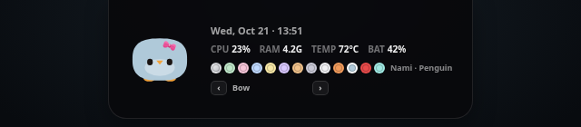
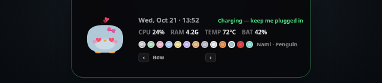
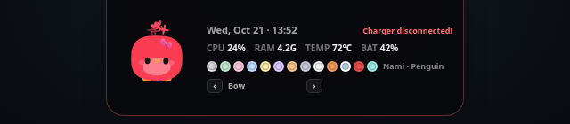
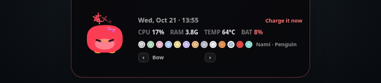
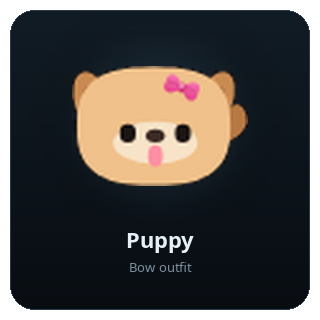
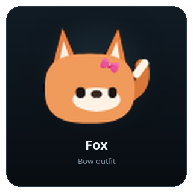
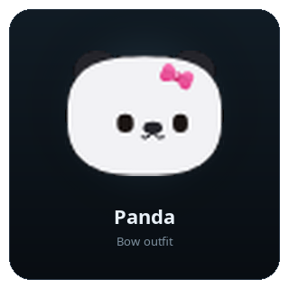

# Nami Notch

A tiny Wayland/Hyprland notch with live system stats and an interactive canvas pet.

Nami hides at the top center of your screen until you hover it. Hovering reveals a compact stats pill; double-clicking the pill opens the full card with the pet, CPU, RAM, temperature, battery, model selector, and outfit controls.

<p align="center">
  
</p>

## Features

- Live CPU, RAM, CPU temperature, and battery readings.
- Nami plus seven pet species: Puppy, Kitty, Panda, Fox, Penguin, Spider, and Robo.
- Six classic Nami colors.
- Outfits including bows, bunny ears, and party hats.
- Hidden top-center trigger with compact and full-card modes.
- Heart eyes and floating hearts while charging.
- Green charging bolt whenever the AC adapter is connected, including when the battery is full or reports "Not charging".
- Three-second angry alert when the charger is disconnected.
- Persistent red low-battery warning.
- Low-power and idle animations, dancing, eye tracking, outfits, and particles.
- No network requests; settings and readings stay local.

## Screenshots

### Compact notch

<p align="center">
  
</p>

### Charging

<p align="center">
  
</p>

### Charger disconnected

<p align="center">
  
</p>

### Low battery

<p align="center">
  
</p>

### More models

Choose any species from the dots in the notch. A few of them:

| Puppy | Fox | Panda |
| :---: | :---: | :---: |
|  |  |  |

## Requirements

- Linux with a Wayland compositor that supports `wlr-layer-shell` (tested on Hyprland).
- Python 3 with PyGObject and Pycairo.
- GTK 3, WebKit2GTK 4.1, and gtk-layer-shell.

Arch Linux:

```bash
sudo pacman -S --needed python-gobject python-cairo gtk3 webkit2gtk-4.1 gtk-layer-shell
```

Debian/Ubuntu package names vary by release; install the equivalents of `python3-gi`, `python3-gi-cairo`, `python3-cairo`, `gir1.2-gtk-3.0`, `gir1.2-webkit2-4.1`, and `gir1.2-gtklayershell-0.1`.

Deno is only needed if you want to rebuild the TypeScript source. The install uses the committed `web/app.js` build.

## Install

```bash
git clone https://github.com/abhinavms404/nami-notch.git
cd nami-notch
./install.sh
```

`install.sh` copies the app to `~/.local/share/nami-notch`, installs the launcher at `~/.local/bin/nami-notch`, creates `~/.config/nami-notch/settings.json` if needed, configures Hyprland autostart when it can find your config, and starts Nami.

Run it again after pulling changes to update the installed copy. Your model/outfit settings are preserved.

```bash
./install.sh --no-autostart
./install.sh --no-start
./install.sh --help
```

If `~/.local/bin` is not in your `PATH`, use the full launcher path or add it to `PATH`:

```bash
export PATH="$HOME/.local/bin:$PATH"
```

## Use

- Move the pointer to the top center of the screen to show the compact notch.
- Double-click the compact notch to open the full card.
- Click a pet dot to change the species or Nami color.
- Use the arrow buttons beside **Bow** to cycle outfits.
- Move the pointer away to hide the card.
- Charging shows heart eyes and floating hearts.
- Unplugging the charger shows the angry disconnect alert for three seconds.
- Below 8% battery, the angry low-battery card stays visible until charging starts.

The launcher can also be run directly:

```bash
GDK_BACKEND=wayland ~/.local/bin/nami-notch
```

Stop the running instance with:

```bash
pkill -f 'python3 .*/nami-notch'
```

## Demo modes

Stop any running instance first because Nami uses a single-instance lock.

```bash
NAMI_DEMO=charging ~/.local/bin/nami-notch
NAMI_DEMO=low ~/.local/bin/nami-notch
NAMI_DEMO=full ~/.local/bin/nami-notch
```

## Settings and logs

- Settings: `~/.config/nami-notch/settings.json`
- Log: `~/.local/share/nami-notch/nami.log`
- App assets: `~/.local/share/nami-notch/web`

The installed settings are created with the classic Nami model. A new install does not overwrite an existing settings file.

## Rebuild

```bash
./build.sh
./install.sh --no-autostart
```

`build.sh` requires Deno and writes `web/app.js` from `src/app.ts`.

## Uninstall

```bash
./uninstall.sh
```

This removes the installed app and launcher but keeps your saved model/outfit settings. Remove them too with:

```bash
./uninstall.sh --purge
```

If your Hyprland config already had a manually added Nami line before installing, it is intentionally left alone.

## License

MIT
